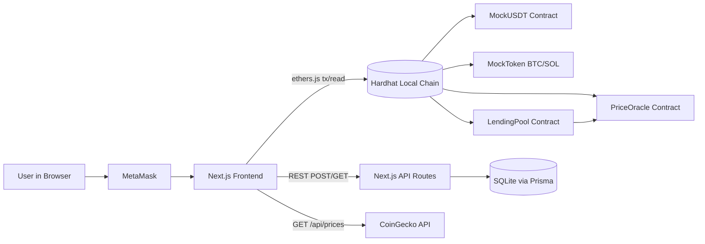

# Project Overview and Architecture

## What CryptoLend Does

CryptoLend is a local demo dApp with three user journeys:

- **Borrow** mUSDT by locking ETH, BTC, or SOL as collateral.
- **Stake** mUSDT and earn continuous time-based rewards.
- **Repay** outstanding loans and withdraw collateral.

The protocol also supports **liquidation** of under-collateralised positions by the treasury wallet.

The project combines:

- Next.js 14 frontend (wallet connection, UI validation, multi-collateral transactions).
- Solidity contracts (ERC20 tokens + lending/staking pool + price oracle).
- Prisma + SQLite (transaction history persistence).
- Hardhat (local chain, deployment, test execution).

## High-Level Architecture

## Main Runtime Flows

### Borrow Flow

1. User connects MetaMask and selects a collateral asset (ETH, BTC, or SOL).
2. Frontend fetches live prices from CoinGecko via `/api/prices` to derive collateral value.
3. Frontend validates local constraints (gas buffer, LTV ceiling, pool liquidity check).
4. For ERC-20 collateral: frontend calls `approve()` on the token contract first.
5. Frontend calls `borrowWithEthCollateral()` (ETH) or `borrowWithTokenCollateral()` (ERC-20).
6. Contract reads `PriceOracle` for the current asset price, validates LTV, then transfers mUSDT.
7. Frontend stores borrow record via POST `/api/borrow-history`.

### Repay Flow

1. User reviews accrued interest (day-granular, 4 % APR) and total debt.
2. Frontend approves mUSDT spending for `LendingPool`.
3. User calls partial repay (`repayUsdt`) or full repay (`repayFullLoan`).
4. Contract requires the repay amount to cover outstanding interest before reducing principal.
5. A 10 % reserve factor is taken from interest paid into `protocolReserveUsdt`.
6. Frontend stores repay record via POST `/api/repay-history`.
7. After full repayment the user can call `withdrawAllCollateral()`.

### Stake Flow

1. User approves mUSDT allowance for LendingPool.
2. User stakes mUSDT using `stakeUsdt()`.
3. Contract auto-claims any pending reward before adding the new stake amount.
4. Frontend saves stake action via POST `/api/staking-history`.

### Claim and Unstake Flow

- `claimRewards()` transfers only the pending reward, leaving principal intact.
- `unstakeUsdt(amount)` transfers principal + any pending reward in a single call.
- Frontend records claim/unstake in staking history API.

### Liquidation Flow (Treasury Only)

1. Admin monitors health factors via the admin panel.
2. When `healthFactorBps <= 11000` (≤ 1.1), a position becomes liquidatable.
3. Treasury calls `liquidate(borrower, assetId, repayAmountUsdt)`.
4. Protocol seizes collateral with a 5 % liquidation bonus and repays debt from treasury funds.

## Protocol Constants and Math

- **Prices**: live from PriceOracle (set at deploy via CoinGecko, refreshable with `update-oracle-prices.js`).
- **Max LTV**: `70 %` ETH/BTC, `65 %` SOL (`MAX_LTV_BPS = 7000 / 6500`).
- **Liquidation threshold**: `85 %` ETH/BTC, `80 %` SOL (configurable by treasury).
- **Interest**: `4 % APR` (`INTEREST_BPS = 400`), accrued per full day.
- **Staking APY**: `3.5 %` (`STAKING_APY_BPS = 350`), accrued per second.
- **Reserve factor**: `10 %` of interest paid (`RESERVE_FACTOR_BPS = 1000`).
- **Liquidation bonus**: `5 %` (`LIQUIDATION_BONUS_BPS = 500`).
- **Liquidation close factor**: `50 %` max of total debt per call (`LIQUIDATION_CLOSE_FACTOR_BPS = 5000`).

Core formulas from contract:

- Collateral value (mUSDT): `(collateralWei * oraclePrice) / 1e18`
- Max borrow (mUSDT): `(collateralValue * ltvBps) / 10000`
- Accrued interest: `(borrowedUsdt * INTEREST_BPS * elapsedDays) / (10000 * 365)`
- Pending reward: `(stakedUsdt * STAKING_APY_BPS * elapsedSeconds) / (10000 * 365 days)`
- Health factor: `(liquidationValue * 10000) / totalDebt` (in BPS; ≤ 11000 triggers liquidation)

## Directory Responsibilities

- `contracts/`: protocol logic in Solidity.
- `scripts/`: deployment and oracle maintenance scripts.
- `src/app/`: frontend UI and Next.js API routes.
- `src/components/`: React components and the global DeFi state context.
- `src/lib/`: ABI/deployment utilities and Prisma singleton.
- `prisma/`: schema and SQLite DB.
- `test/`: Hardhat unit/integration tests.

Read the file map doc for detailed per-file responsibilities.
