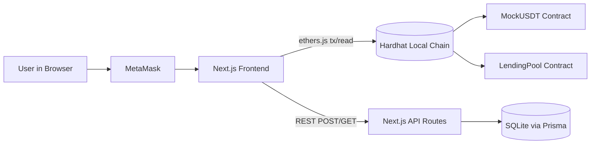

# Project Overview and Architecture

## What CryptoLend Does

CryptoLend is a local demo dApp with two user journeys:

- Borrow mUSDT by locking ETH as collateral.
- Stake mUSDT and earn time-based rewards.

The project combines:

- Next.js frontend (wallet connection, UI validation, transactions).
- Solidity contracts (token + lending/staking pool).
- Prisma + SQLite (transaction history persistence).
- Hardhat (local chain, deployment, test execution).

## High-Level Architecture

## Main Runtime Flows

### Borrow Flow

1. User connects MetaMask and selects collateral + borrow amount.
2. Frontend validates local constraints (gas buffer, LTV, liquidity checks).
3. Frontend calls `borrowWithEthCollateral()` on `LendingPool`.
4. Contract validates collateral, LTV, and pool liquidity.
5. Pool transfers mUSDT to borrower and stores/updates loan position.
6. Frontend stores borrow history via `/api/borrow-history`.

### Stake Flow

1. User approves mUSDT allowance for LendingPool.
2. User stakes mUSDT using `stakeUsdt()`.
3. Contract auto-claims pending reward (if any), then increases stake.
4. Frontend saves stake action via `/api/staking-history`.

### Claim and Unstake Flow

- `claimRewards()` transfers only reward.
- `unstakeUsdt(amount)` transfers principal + pending reward.
- Frontend records claim/unstake in staking history API.

## Protocol Constants and Math

- Price: `1 ETH = 100 mUSDT`.
- Max LTV: `70%`.
- Interest constant exposed: `4%` (`INTEREST_BPS = 400`).
- Staking APY: `12%` (`STAKING_APY_BPS = 1200`).

Core formulas from contract:

- Collateral value (mUSDT):
  - `(collateralWei * PRICE_USDT_PER_ETH * 1e6) / 1e18`
- Max borrow (mUSDT):
  - `(collateralValue * 7000) / 10000`
- Pending reward:
  - `(principal * 1200 * elapsedSeconds) / (10000 * 365 days)`

## Directory Responsibilities

- `contracts/`: protocol logic in Solidity.
- `scripts/`: deployment and maintenance scripts.
- `src/app/`: frontend UI and API routes.
- `src/lib/`: ABI/deployment utilities and Prisma singleton.
- `prisma/`: schema and SQLite DB.
- `test/`: Hardhat unit/integration tests.

Read the file map doc for detailed per-file responsibilities.
